<link rel="stylesheet" href="../scripts/style.css">
<meta charset="utf-8">
<link rel="icon" type="image/png" href="vr/salas/imagens/icone.png">
<h2>Visualization of Fractal curves with polyhedra in Virtual Reality (VR) with A-frame</h2>
 <b>author:</b> Paulo Henrique Siqueira - Universidade Federal do Paraná
  <b>contact:</b> <a href="#">paulohscwb@gmail.com</a>
  <a href="https://paulohscwb.github.io/fractalcurves/pine/pt-br/">versão em português</a>
 <form style="margin: 0 auto; float:right; text-align:right; width:100%; margin-bottom:15px;">
	<select id="url" onchange="urlHandler(this.value)" style="color:royalblue;">
		<option disabled selected value>More fractals:</option>
		<option value="../dragoneve/">Dragon of Eve</option>
		<option value="../et/">E.T. the extra-terrestrial curve</option>
		<option value="../cat/">Cat curve</option>
		<option value="../levy/">Lévy curve</option>
		<option value="../apple/">Apple curve</option>
		<option value="../holidaytree/">Holiday tree curve</option>
		<option disabled value="../pine/">Pine tree curve</option>
		<option value="../snowflake/">Snowflake curve</option>
	</select>
</form>

  <h2 align="center"> Pine tree curve fractals with polyhedra</h2>
The Pine Curve is a variation of the Sierpinski triangle. Four segments have the same length, and the central segment is twice as long as the others. The angle formed between the segments that connect the outer segments to the central (longer) one measures 60°. 

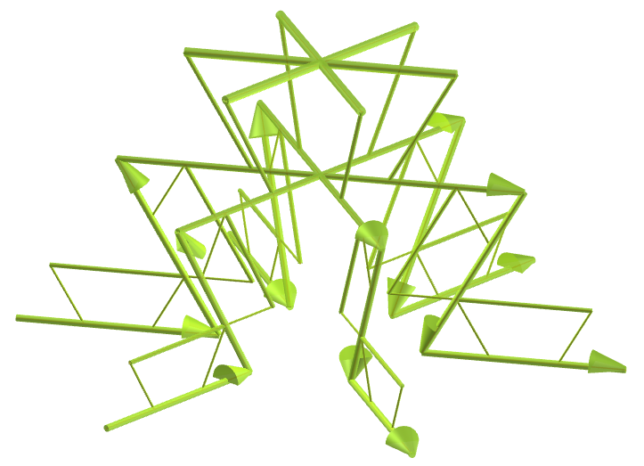

 This work shows Pine tree curve fractals with polyhedra, modeled for visualization in Virtual Reality.

<a href="#m3d">3D Models</a>&nbsp;&nbsp;|&nbsp;&nbsp;<a href="../">Home</a>

 
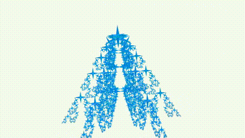
 

<h3 id="m3d" align="center">3D models</h3>
<!--<iframe width="560" height="315" style="max-width:100%" src="https://www.youtube.com/embed/videoseries?list=PLy0I_lGW8HxWlEMWcE07sVoIKTXMkqHZF" title="YouTube video player" frameborder="0" allow="accelerometer; autoplay; clipboard-write; encrypted-media; gyroscope; picture-in-picture; web-share" allowfullscreen></iframe>-->
<h4>1. Tetrahedron</h4>
<a href="vr/curve1.htm" target="_blank" title="3D model" class="fotoA">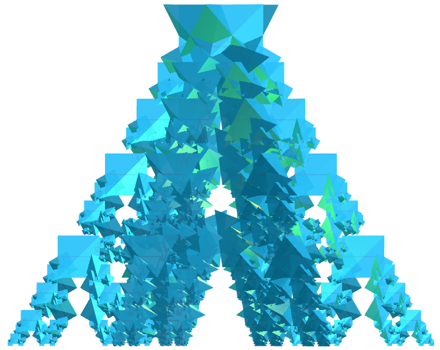</a>
  Applying the construction principle of the pine tree curve with the tetrahedron, we obtain an tetrahedron pine tree curve fractal. In the first order of construction of the fractal, we construct five new tetrahedra corresponding to one original polyhedron. In this example, we have solid representations in orders from 0 to 4. 
  

<h4>2. Octahedron</h4>
<a href="vr/curve5.htm" target="_blank" title="3D model" class="fotoA">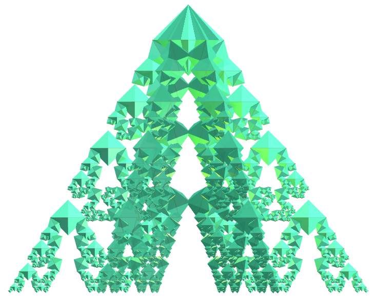</a>
  Octahedron pine tree curve fractal.
  

<h4>3. Great dodecahedron</h4>

  Great dodecahedron pine tree curve fractal.
  

<h4>4. Great icosahedron</h4>

  Great icosahedron pine tree curve fractal.
  

<h4>5. Truncated icosahedron</h4>
<a href="vr/curve15.htm" target="_blank" title="3D model" class="fotoA">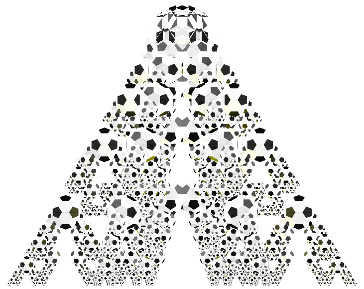</a>
  Truncated icosahedron pine tree curve fractal.
  

<h4>6. Hexahemioctacron</h4>
<a href="vr/curve19.htm" target="_blank" title="3D model" class="fotoA">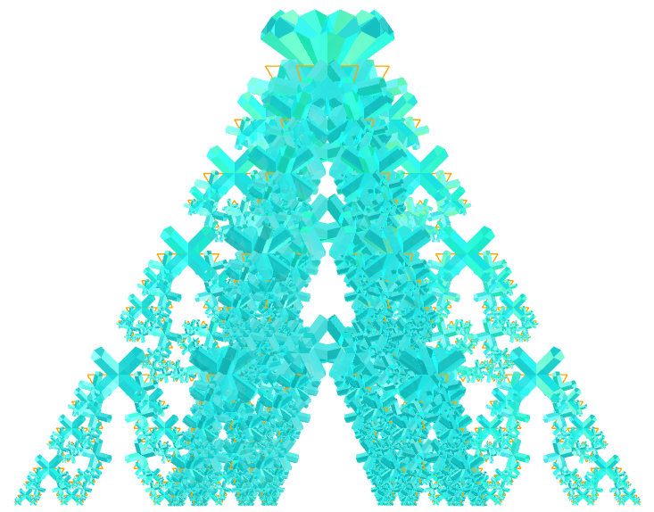</a>
  Hexahemioctacron pine tree curve fractal.
  

<h4>7. Jessens Orthogonal Icosahedron</h4>
<a href="vr/curve25.htm" target="_blank" title="3D model" class="fotoA">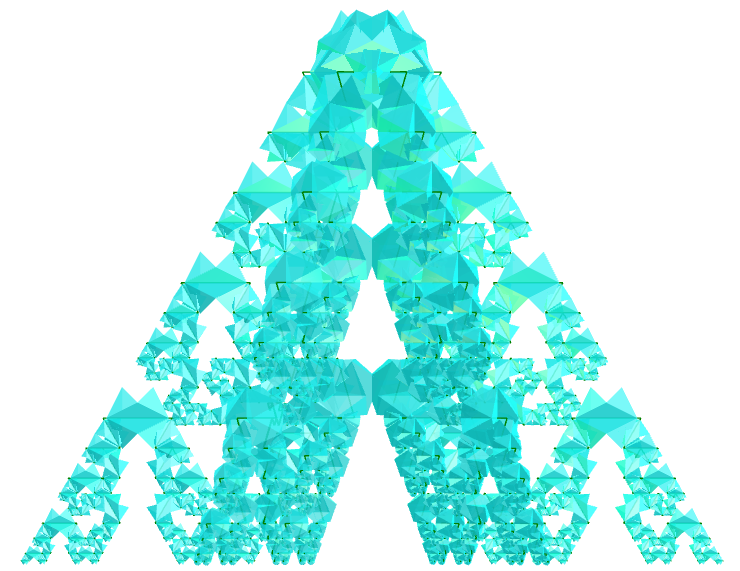</a>
  Jessens Orthogonal Icosahedron pine tree curve fractal.
  

<h4>8. Small ditrigonal dodecacronic hexecontahedron</h4>
<a href="vr/curve33.htm" target="_blank" title="3D model" class="fotoA">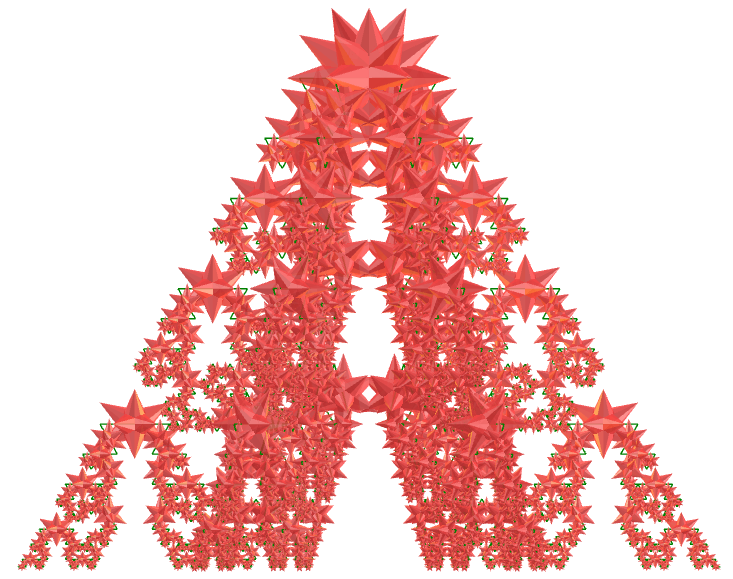</a>
  Small ditrigonal dodecacronic hexecontahedron pine tree curve fractal.
  

<h4>9. Great cubicuboctahedron</h4>
<a href="vr/curve35.htm" target="_blank" title="3D model" class="fotoA">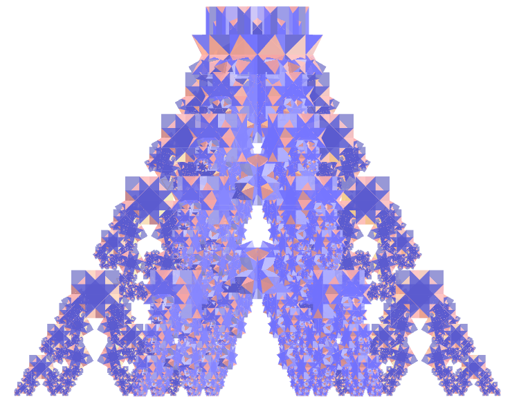</a>
  Great cubicuboctahedron pine tree curve fractal.
  

<h4>10. Great rhombihexacron</h4>
<a href="vr/curve39.htm" target="_blank" title="3D model" class="fotoA">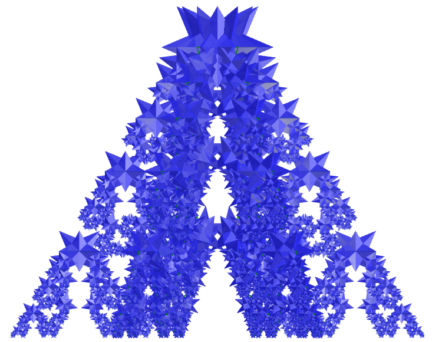</a>
  Great rhombihexacron pine tree curve fractal.
  

<a href="#p1" class="topo">back to top</a>

<h4>11. Tetradyakis hexahedron</h4>
<a href="vr/curve45.htm" target="_blank" title="3D model" class="fotoA">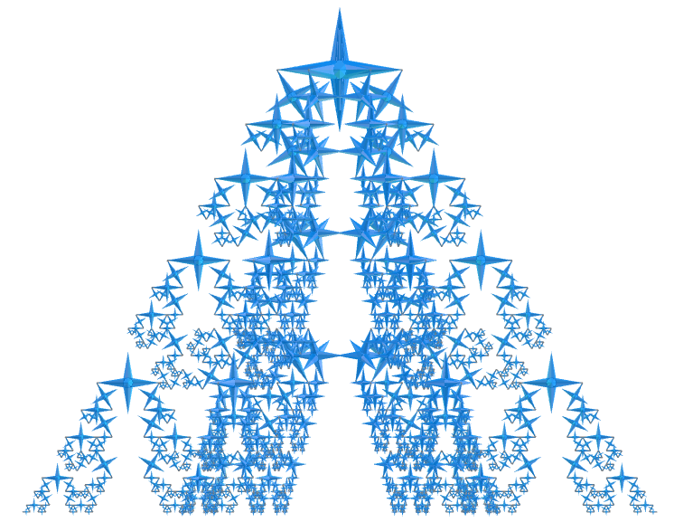</a>
  Tetradyakis hexahedron pine tree curve fractal.
  

<h4>12. Great triakis icosahedron</h4>

  Great triakis icosahedron pine tree curve fractal.
  

<h4>13. Joined truncated cube</h4>
<a href="vr/curve57.htm" target="_blank" title="3D model" class="fotoA">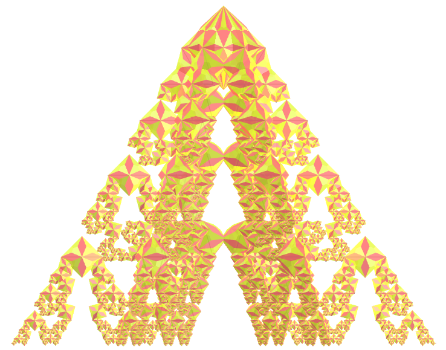</a>
  Joined truncated cube pine tree curve fractal.
  

<h4>14. Rhombicuboctahedron</h4>
<a href="vr/curve65.htm" target="_blank" title="3D model" class="fotoA">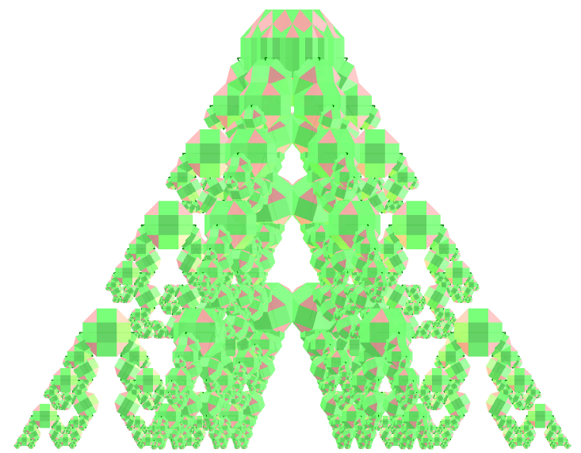</a>
  Rhombicuboctahedron pine tree curve fractal.
  

<h4>15. Heptagonal dodecahedron</h4>
<a href="vr/curve75.htm" target="_blank" title="3D model" class="fotoA">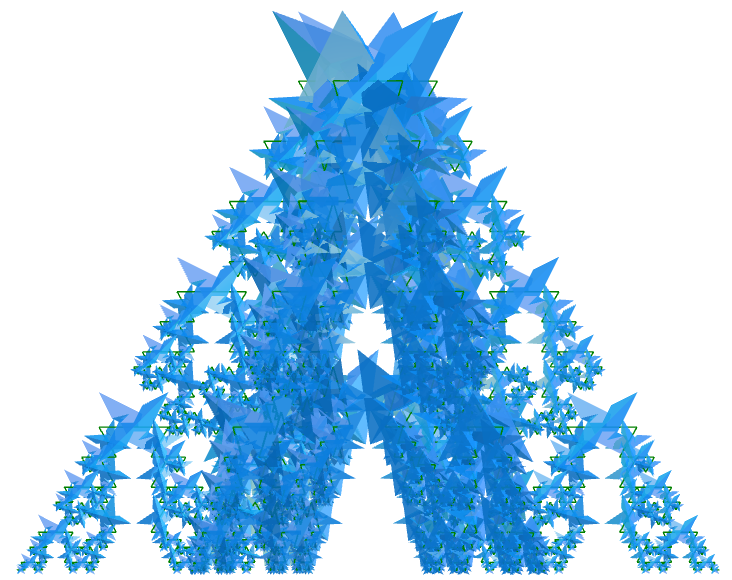</a>
  Heptagonal dodecahedron pine tree curve fractal.
  

<h4>16. Regular map</h4>
<a href="vr/curve85.htm" target="_blank" title="3D model" class="fotoA">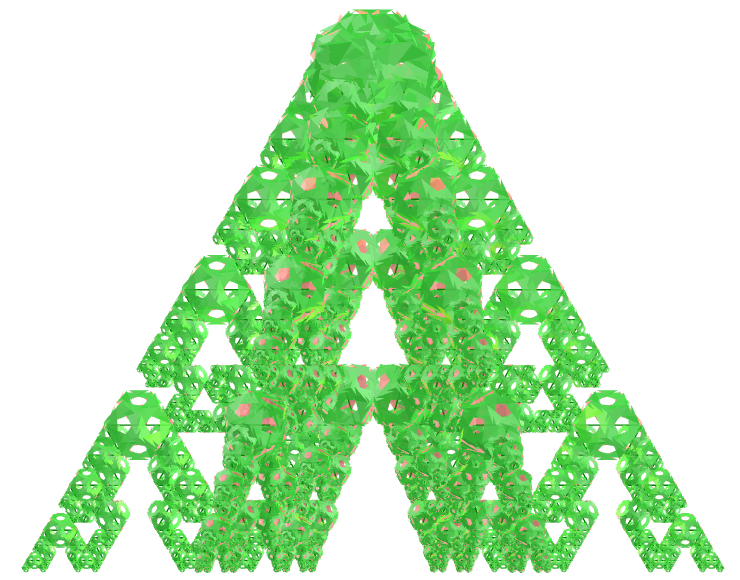</a>
  Regular map pine tree curve fractal.
  

<h4>17. Hexagrammic prism</h4>

  Hexagrammic prism pine tree curve fractal.
  

<h4>18. Flower of life</h4>
<a href="vr/curve105.htm" target="_blank" title="3D model" class="fotoA">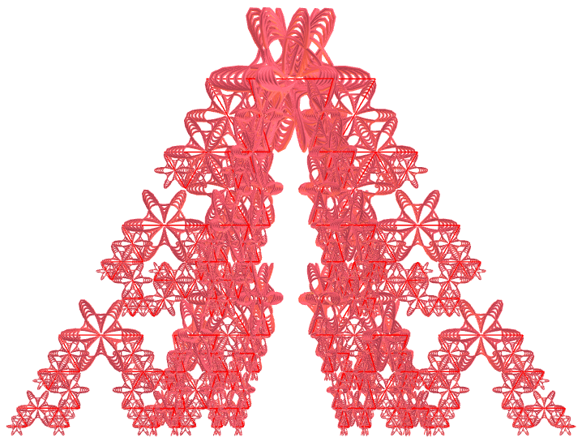</a>
  Flower of life pine tree curve fractal.
  

<h4>19. Medial rhombic triacontahedron</h4>
<a href="vr/curve115.htm" target="_blank" title="3D model" class="fotoA">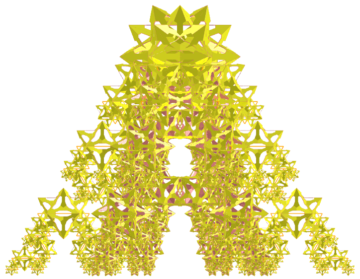</a>
  Medial rhombic triacontahedron pine tree curve fractal.
  

<h4>20. Small hexagonal hexecontahedron</h4>
<a href="vr/curve125.htm" target="_blank" title="3D model" class="fotoA">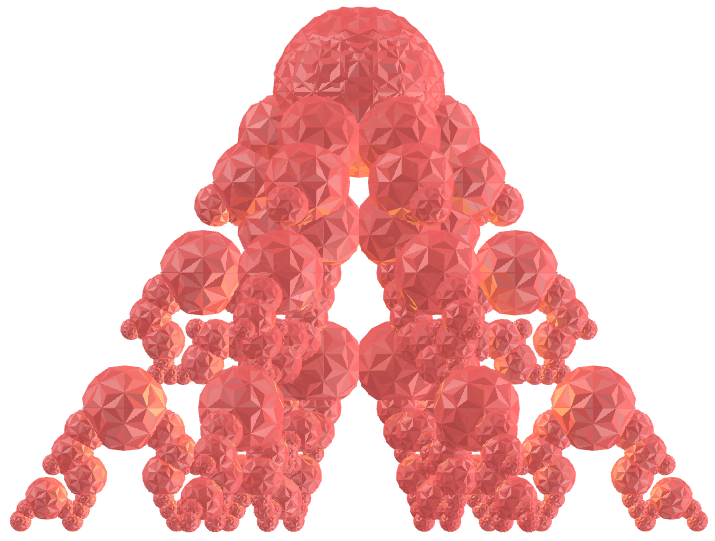</a>
  Small hexagonal hexecontahedron pine tree curve fractal.
  

<a href="#p1" class="topo">back to top</a>

<h4>21. Great disdyakis dodecahedron</h4>
<a href="vr/curve135.htm" target="_blank" title="3D model" class="fotoA">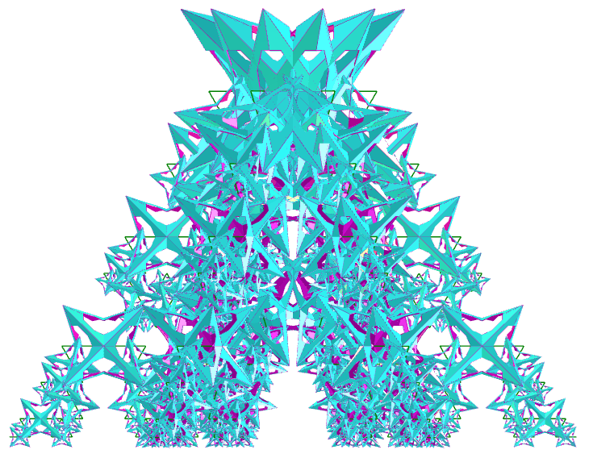</a>
  Great disdyakis dodecahedron pine tree curve fractal.
  

<a href="#p1" class="topo">back to top</a>

  Pine tree curve fractals with polyhedra: visualization with Virtual Reality by <a xmlns:cc="http://creativecommons.org/ns#" href="https://paulohscwb.github.io/fractalcurves/pine/" property="cc:attributionName" rel="cc:attributionURL">Paulo Henrique Siqueira</a> is licensed with a license <a rel="license" href="http://creativecommons.org/licenses/by-nc-nd/4.0/">Creative Commons Attribution-NonCommercial-NoDerivatives 4.0 International</a>.

<h4>How to cite this work:</h4> 

Siqueira, P.H., "Pine tree curve fractals with polyhedra: visualization with Virtual Reality". Available in: <https://paulohscwb.github.io/fractalcurves/dragoneve/>, November 2026.

<!---->
  <b>References:</b>
 Ventrella, Jeffrey. "Fractal curves". <a href="http://fractalcurves.com/" target="_blank">http://fractalcurves.com/</a>
 Weisstein, Eric W. "Uniform Polyhedron." From MathWorld--A Wolfram Web Resource. <a href="https://mathworld.wolfram.com/UniformPolyhedron.html" target="_blank">https://mathworld.wolfram.com/UniformPolyhedron.html</a>
 McCooey, D. I. "Visual Polyhedra". <a href="http://dmccooey.com/polyhedra/" target="_blank">http://dmccooey.com/polyhedra/</a>
