<link rel="stylesheet" href="../scripts/style.css">
<meta charset="utf-8">
<link rel="icon" type="image/png" href="vr/salas/imagens/icone.png">
<h2>Visualization of Fractal curves with polyhedra in Virtual Reality (VR) with A-frame</h2>
 <b>author:</b> Paulo Henrique Siqueira - Universidade Federal do Paraná
  <b>contact:</b> <a href="#">paulohscwb@gmail.com</a>
  <a href="https://paulohscwb.github.io/fractalcurves/snowflake/pt-br/">versão em português</a>
 <form style="margin: 0 auto; float:right; text-align:right; width:100%; margin-bottom:15px;">
	<select id="url" onchange="urlHandler(this.value)" style="color:royalblue;">
		<option disabled selected value>More fractals:</option>
		<option value="../dragoneve/">Dragon of Eve</option>
		<option value="../et/">E.T. the extra-terrestrial curve</option>
		<option value="../cat/">Cat curve</option>
		<option value="../levy/">Lévy curve</option>
		<option value="../apple/">Apple curve</option>
		<option value="../holidaytree/">Holiday Tree curve</option>
		<option value="../pine/">Pine tree curve</option>
		<option disabled value="../snowflake/">Snowflake curve</option>
	</select>
</form>

  <h2 align="center"> Snowflake curve fractals with polyhedra</h2>
The snowflake curve is a variation of the Koch snowflake. Six segments have the same length <b>a</b>, and the central segment has a length equal to <b>a&radic;3</b>. The angles formed between the segments measure 30&deg; and 60&deg;.

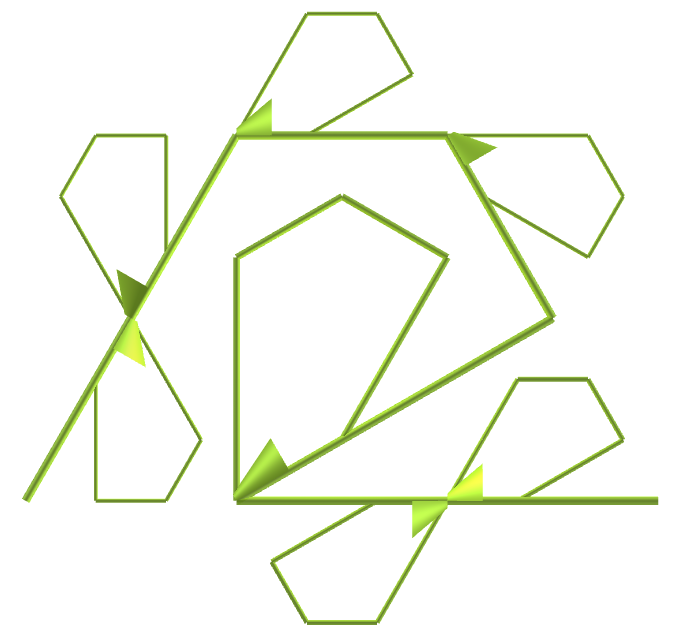

 This work shows snowflake curve fractals with polyhedra, modeled for visualization in Virtual Reality.

<a href="#m3d">3D Models</a>&nbsp;&nbsp;|&nbsp;&nbsp;<a href="../">Home</a>

 
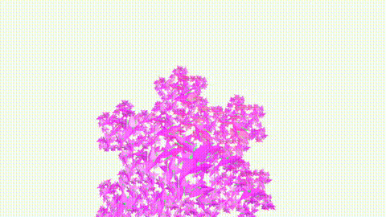
 

<h3 id="m3d" align="center">3D models</h3>
<!--<iframe width="560" height="315" style="max-width:100%" src="https://www.youtube.com/embed/videoseries?list=PLy0I_lGW8HxWlEMWcE07sVoIKTXMkqHZF" title="YouTube video player" frameborder="0" allow="accelerometer; autoplay; clipboard-write; encrypted-media; gyroscope; picture-in-picture; web-share" allowfullscreen></iframe>-->
<h4>1. Tetrahedron</h4>
<a href="vr/curve1.htm" target="_blank" title="3D model" class="fotoA">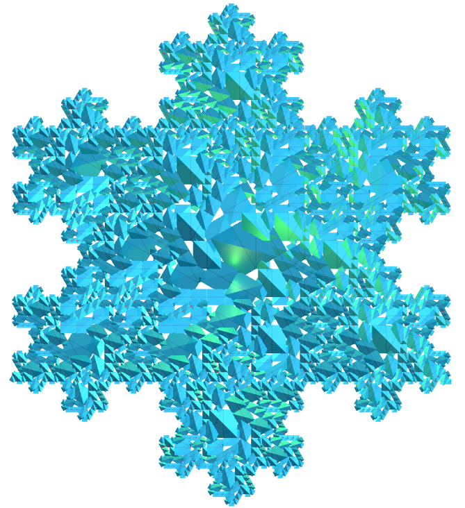</a>
  Applying the construction principle of the snowflake curve with the tetrahedron, we obtain an tetrahedron snowflake fractal. In the first order of construction of the fractal, we construct seven new tetrahedra corresponding to one original polyhedron. In this example, we have solid representations in orders from 0 to 4. 
  

<h4>2. Great dodecahedron</h4>
<a href="vr/curve6.htm" target="_blank" title="3D model" class="fotoA">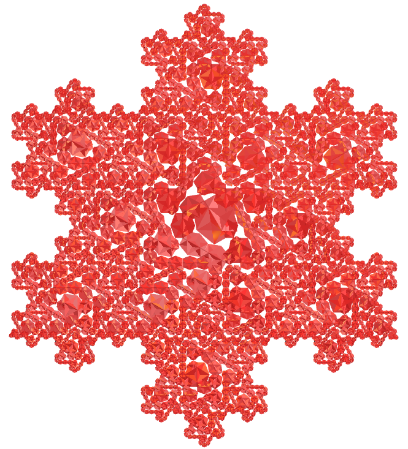</a>
  Great dodecahedron snowflake curve fractal.
  

<h4>3. Small stellated dodecahedron</h4>
<a href="vr/curve11.htm" target="_blank" title="3D model" class="fotoA">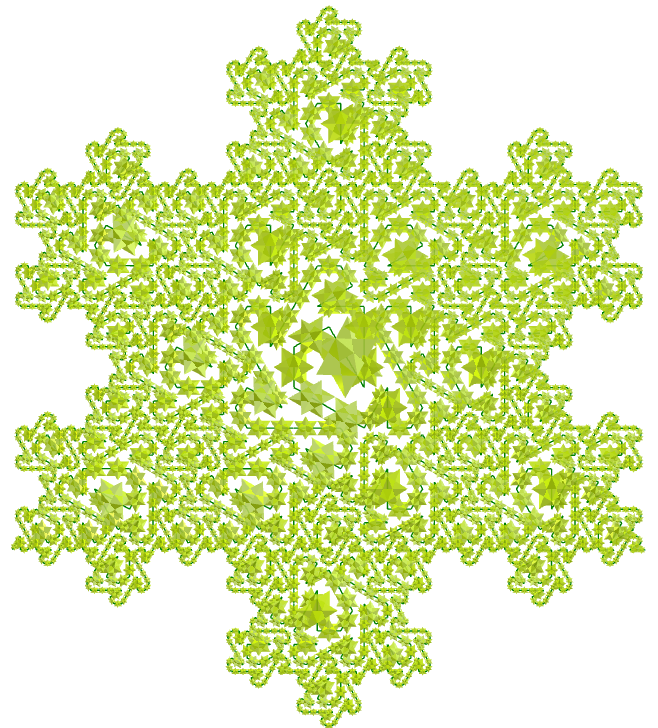</a>
  Small stellated dodecahedron snowflake curve fractal.
  

<h4>4. Snub dodecahedron</h4>
<a href="vr/curve16.htm" target="_blank" title="3D model" class="fotoA">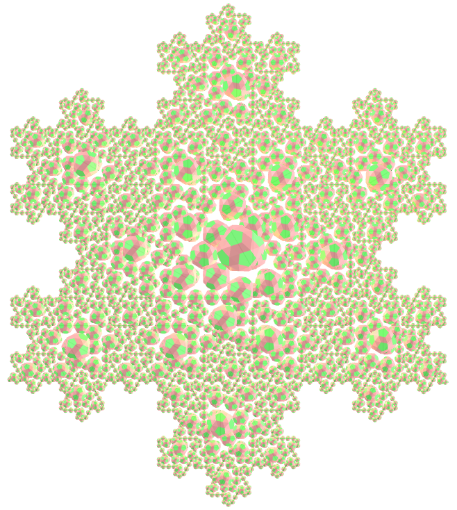</a>
  Snub dodecahedron snowflake curve fractal.
  

<h4>5. Small Icosihemidodecacron</h4>
<a href="vr/curve20.htm" target="_blank" title="3D model" class="fotoA">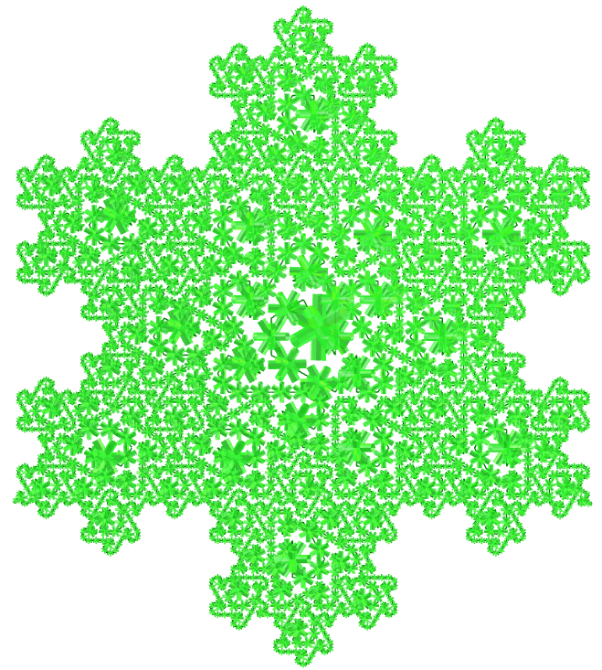</a>
  Small Icosihemidodecacron snowflake curve fractal.
  

<h4>6. Dyakis dodecahedron</h4>
<a href="vr/curve26.htm" target="_blank" title="3D model" class="fotoA">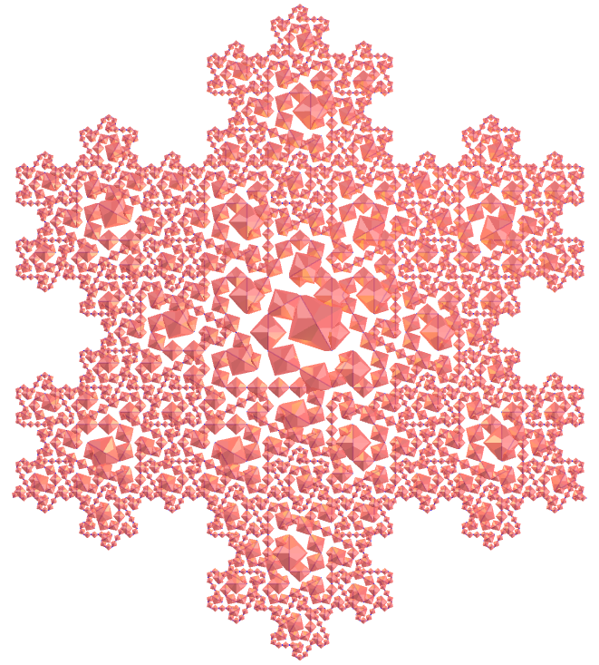</a>
  Dyakis dodecahedron snowflake curve fractal.
  

<h4>7. Great hexacronic icositetrahedron</h4>
<a href="vr/curve28.htm" target="_blank" title="3D model" class="fotoA">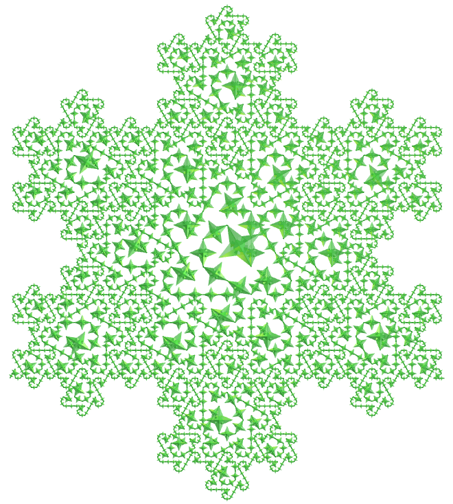</a>
  Great hexacronic icositetrahedron snowflake curve fractal.
  

<h4>8. Great triambic icosahedron</h4>
<a href="vr/curve34.htm" target="_blank" title="3D model" class="fotoA">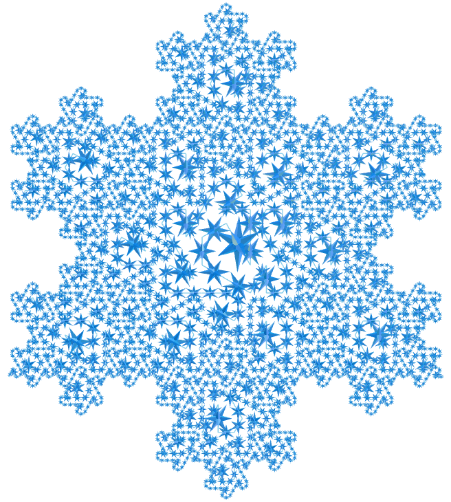</a>
  Great triambic icosahedron snowflake curve fractal.
  

<h4>9. Uniform great rhombicuboctahedron</h4>
<a href="vr/curve36.htm" target="_blank" title="3D model" class="fotoA">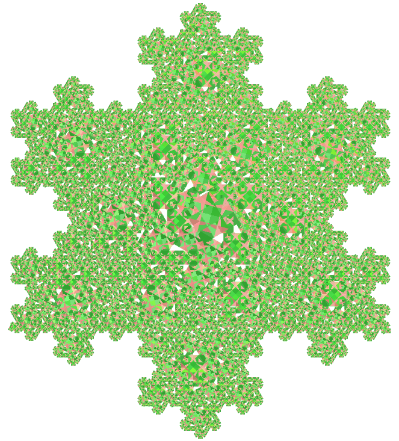</a>
  Uniform great rhombicuboctahedron snowflake curve fractal.
  

<h4>10. Great triakis octahedron</h4>
<a href="vr/curve46.htm" target="_blank" title="3D model" class="fotoA">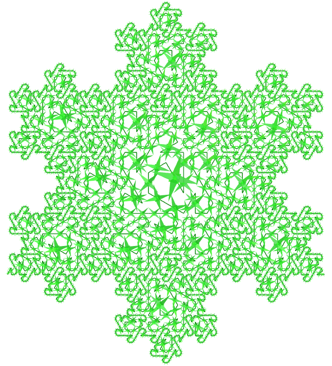</a>
  Great triakis octahedron snowflake curve fractal.
  

<a href="#p1" class="topo">back to top</a>

<h4>11. Truncated great icosahedron</h4>
<a href="vr/curve52.htm" target="_blank" title="3D model" class="fotoA">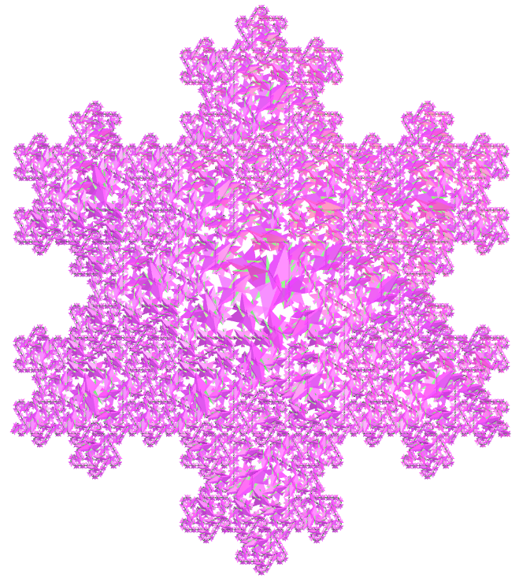</a>
  Truncated great icosahedron snowflake curve fractal.
  

<h4>12. Great disdyakis triacontahedron</h4>
<a href="vr/curve56.htm" target="_blank" title="3D model" class="fotoA">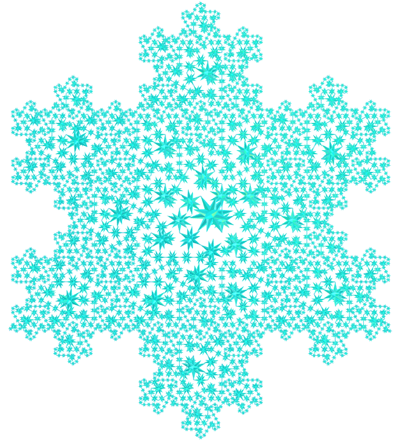</a>
  Great disdyakis triacontahedron snowflake curve fractal.
  

<h4>13. Joined truncated cube</h4>
<a href="vr/curve57.htm" target="_blank" title="3D model" class="fotoA">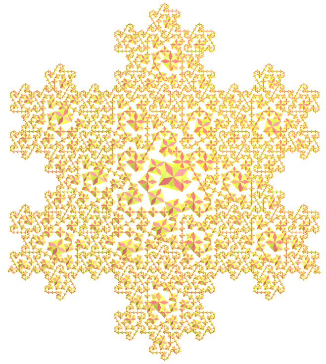</a>
  Joined truncated cube snowflake curve fractal.
  

<h4>14. Truncated tetrahedron</h4>
<a href="vr/curve66.htm" target="_blank" title="3D model" class="fotoA">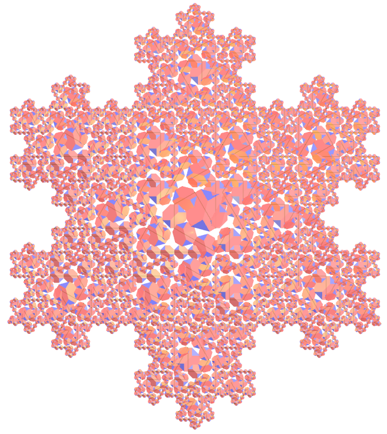</a>
  Truncated tetrahedron snowflake curve fractal.
  

<h4>15. Heptagonal dodecahedron</h4>
<a href="vr/curve76.htm" target="_blank" title="3D model" class="fotoA">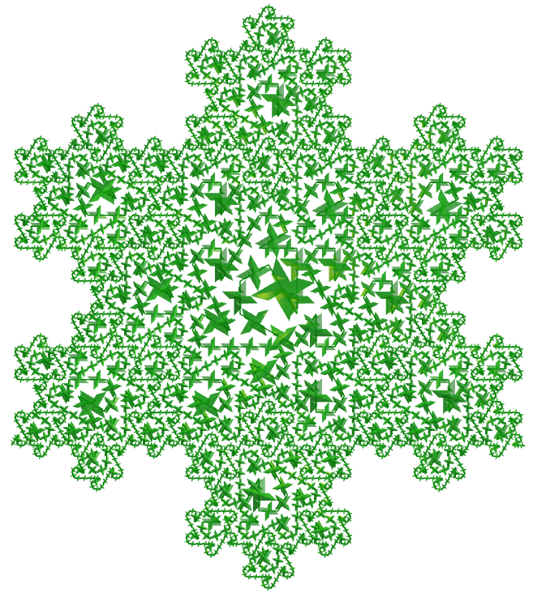</a>
  Heptagonal dodecahedron snowflake curve fractal.
  

<h4>16. Regular map</h4>
<a href="vr/curve86.htm" target="_blank" title="3D model" class="fotoA">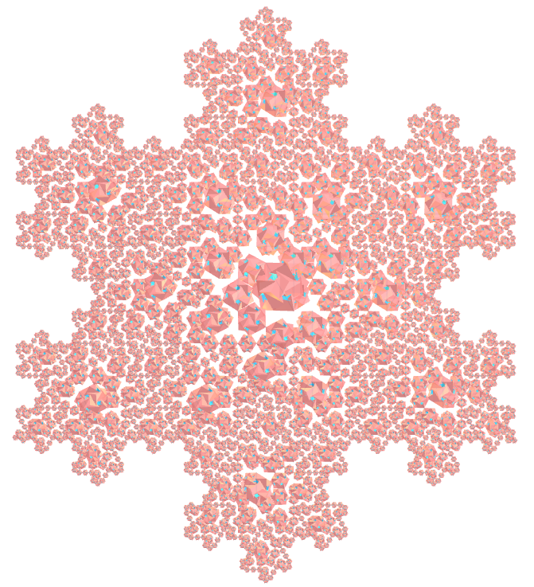</a>
  Regular map snowflake curve fractal.
  

<h4>17. Hexagonal prism</h4>
<a href="vr/curve90.htm" target="_blank" title="3D model" class="fotoA">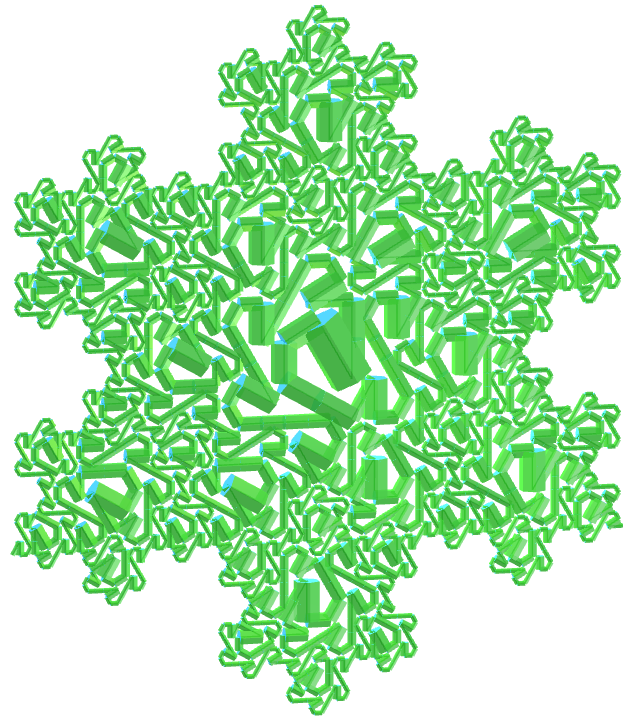</a>
  Hexagonal prism snowflake curve fractal.
  

<h4>18. Flower of life</h4>
<a href="vr/curve106.htm" target="_blank" title="3D model" class="fotoA">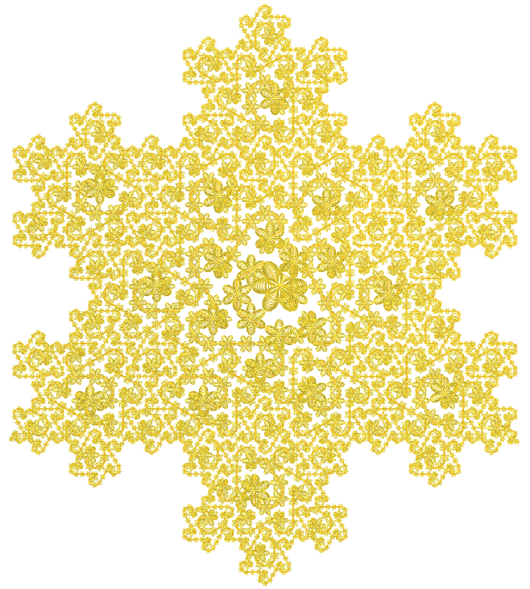</a>
  Flower of life snowflake curve fractal.
  

<h4>19. Möbius hexakis octahedron</h4>
<a href="vr/curve116.htm" target="_blank" title="3D model" class="fotoA">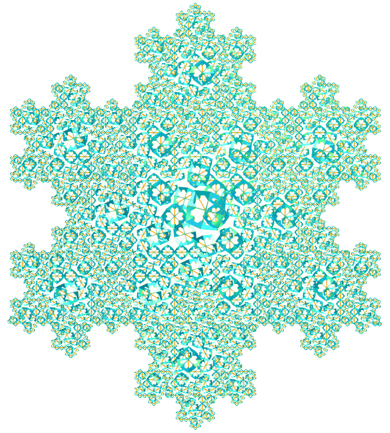</a>
  Möbius hexakis octahedron snowflake curve fractal.
  

<h4>20. Medial icosacronic hexecontahedron</h4>
<a href="vr/curve126.htm" target="_blank" title="3D model" class="fotoA">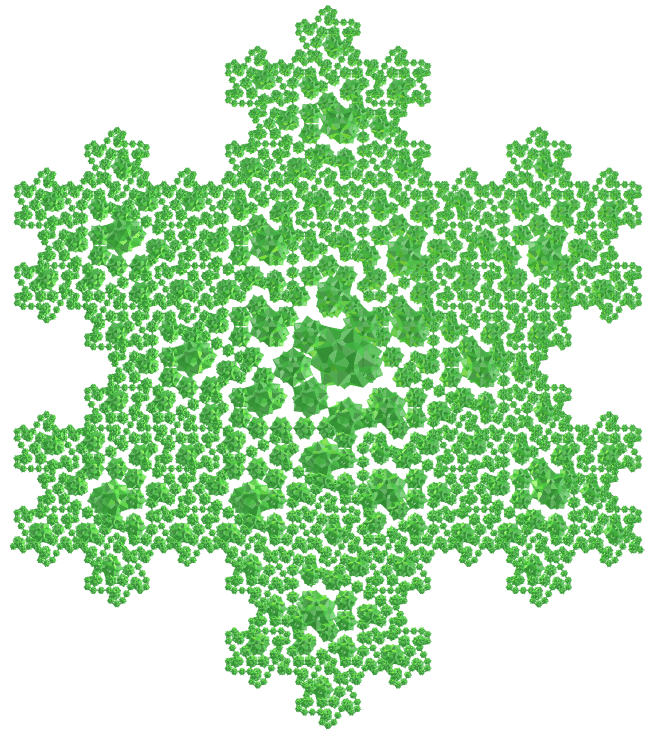</a>
  Medial icosacronic hexecontahedron snowflake curve fractal.
  

<a href="#p1" class="topo">back to top</a>

<h4>21. Great rhombihexacron</h4>
<a href="vr/curve136.htm" target="_blank" title="3D model" class="fotoA">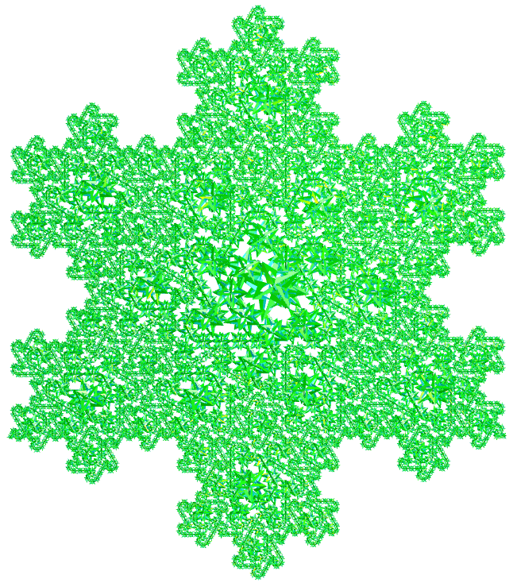</a>
  Great rhombihexacron snowflake curve fractal.
  

<a href="#p1" class="topo">back to top</a>

  Snowflake curve fractals with polyhedra: visualization with Virtual Reality by <a xmlns:cc="http://creativecommons.org/ns#" href="https://paulohscwb.github.io/fractalcurves/snowflake/" property="cc:attributionName" rel="cc:attributionURL">Paulo Henrique Siqueira</a> is licensed with a license <a rel="license" href="http://creativecommons.org/licenses/by-nc-nd/4.0/">Creative Commons Attribution-NonCommercial-NoDerivatives 4.0 International</a>.

<h4>How to cite this work:</h4> 

Siqueira, P.H., "Snowflake curve fractals with polyhedra: visualization with Virtual Reality". Available in: <https://paulohscwb.github.io/fractalcurves/snowflake/>, February 2026.

<!---->
  <b>References:</b>
 Ventrella, Jeffrey. "Fractal curves". <a href="http://fractalcurves.com/" target="_blank">http://fractalcurves.com/</a>
 Weisstein, Eric W. "Uniform Polyhedron." From MathWorld--A Wolfram Web Resource. <a href="https://mathworld.wolfram.com/UniformPolyhedron.html" target="_blank">https://mathworld.wolfram.com/UniformPolyhedron.html</a>
 McCooey, D. I. "Visual Polyhedra". <a href="http://dmccooey.com/polyhedra/" target="_blank">http://dmccooey.com/polyhedra/</a>
