<link rel="stylesheet" href="../../scripts/style.css">
<meta charset="utf-8">
<link rel="icon" type="image/png" href="../vr/salas/imagens/icone.png">
<h2>Visualização de Curvas Fractais de poliedros em Realidade Virtual (RV) com A-frame</h2>
<b>autor:</b> Paulo Henrique Siqueira - Universidade Federal do Paraná
 <b>contato:</b> <a href="#"> paulohscwb@gmail.com </a>
 <a href="https://paulohscwb.github.io/fractalcurves/snowflake/">english version</a>
<form style="margin: 0 auto; float:right; text-align:right; width:100%; margin-bottom:15px;">
	<select id="url" onchange="urlHandler(this.value)" style="color:royalblue;">
		<option disabled selected>Mais fractais:</option>
		<option value="../../dragoneve/pt-br/">Dragão de Eve</option>
		<option value="../../et/pt-br/">Curva do E.T., o extra-terrestre</option>
		<option value="../../cat/pt-br/">Curva do gato</option>
		<option value="../../levy/pt-br/">Curva de Lévy</option>
		<option value="../../apple/pt-br/">Curva da maçã</option>
		<option value="../../holidaytree/pt-br/">Curva de árvore de Natal</option>
		<option value="../../pine/pt-br/">Curva de pinheiro</option>
		<option disabled value="../../snowflake/pt-br/">Curva de floco de neve</option>
	</select>
</form>

  <h2 align="center">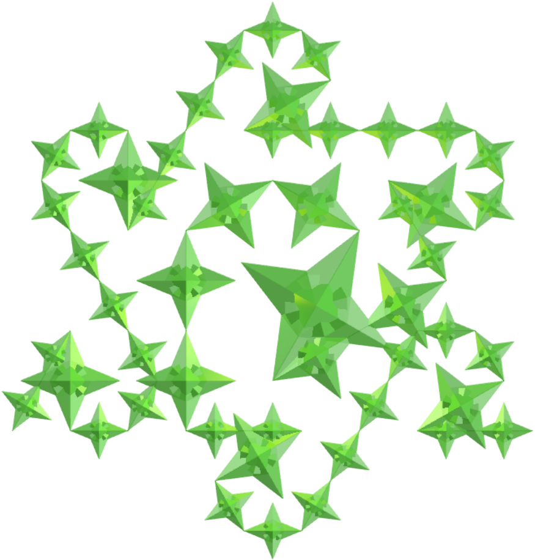 Fractais da curva de floco de neve com poliedros</h2>
  A Curva de floco de neve é uma variação do floco de neve de Koch. Seis segmentos têm a mesma medida <b>a</b>, e o segmento central tem comprimento igual a <b>a&radic;3</b>. Os ângulos formados entre os segmentos medem 30&deg; e 60&deg;.
  
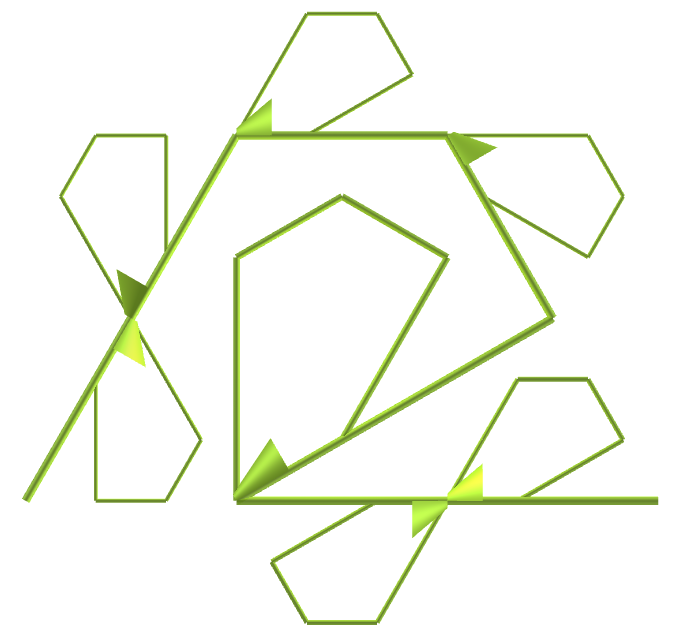

 Este trabalho mostra fractais da curva de floco de neve com poliedros, modelados para visualização em Realidade Virtual.
 
<a href="#m3d">Modelos 3D</a>&nbsp;&nbsp;|&nbsp;&nbsp;<a href="../../pt-br/">Página Inicial</a>

  
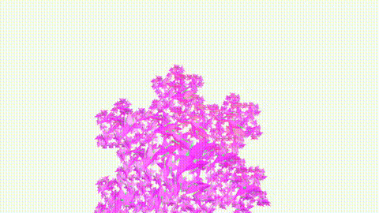
 

<h3 id="m3d" align="center">Modelos 3D</h3>
<!--<iframe width="560" height="315" style="max-width:100%" src="https://www.youtube.com/embed/videoseries?list=PLy0I_lGW8HxWlEMWcE07sVoIKTXMkqHZF" title="YouTube video player" frameborder="0" allow="accelerometer; autoplay; clipboard-write; encrypted-media; gyroscope; picture-in-picture; web-share" allowfullscreen></iframe>-->
<h4>1. Tetraedro</h4>
<a href="../vr/curve1.htm" target="_blank" title="modelo 3D" class="fotoA">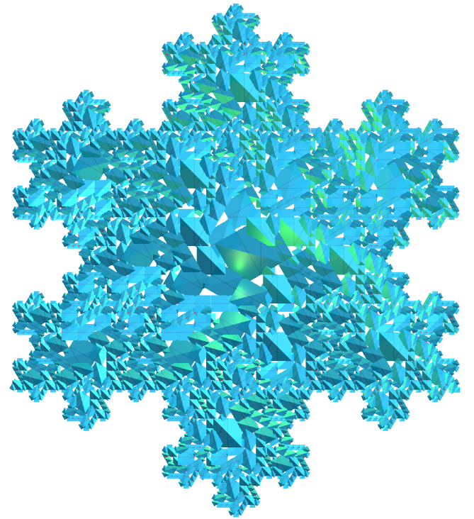</a>
  Aplicando o princípio de construção da curva de floco de neve com o tetraedro, obtemos um fractal da curva de floco de neve de tetraedro. Na primeira ordem de construção do fractal, construímos três novos tetraedros correspondentes a um poliedro original. Neste exemplo, temos representações de ordens de 0 a 4.
  

<h4>2. Grande dodecaedro</h4>
<a href="../vr/curve6.htm" target="_blank" title="modelo 3D" class="fotoA">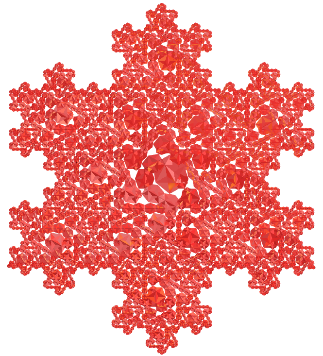</a>
  Fractal de curva de floco de neve do grande dodecaedro.
  

<h4>3. Pequeno dodecaedro estrelado</h4>
<a href="../vr/curve11.htm" target="_blank" title="modelo 3D" class="fotoA">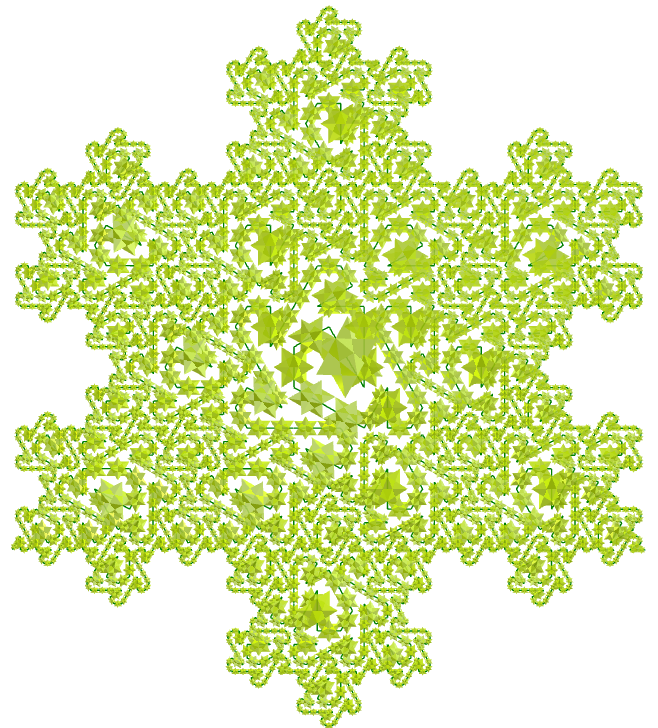</a>
  Fractal de curva de floco de neve do pequeno dodecaedro estrelado.
  

<h4>4. Dodecaedro snub</h4>
<a href="../vr/curve16.htm" target="_blank" title="modelo 3D" class="fotoA">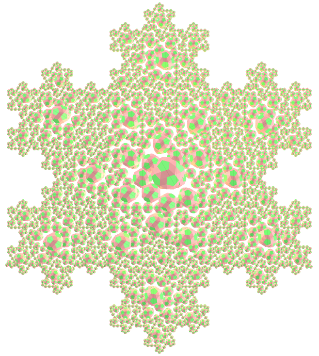</a>
  Fractal de curva de floco de neve do dodecaedro snub.
  

<h4>5. Pequeno icosihemidodecacron</h4>
<a href="../vr/curve20.htm" target="_blank" title="modelo 3D" class="fotoA">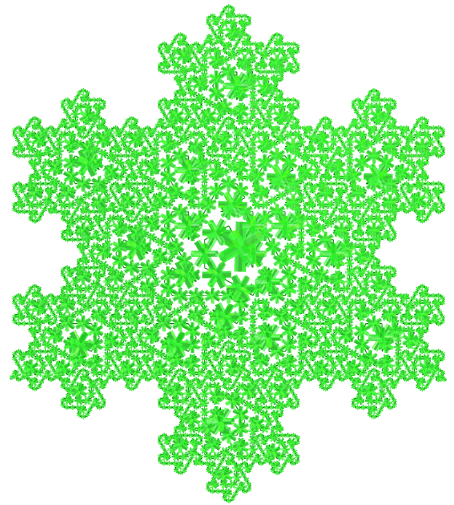</a>
  Fractal de curva de floco de neve do pequeno icosihemidodecacron.
  

<h4>6. Dodecaedro diakis</h4>
<a href="../vr/curve26.htm" target="_blank" title="modelo 3D" class="fotoA">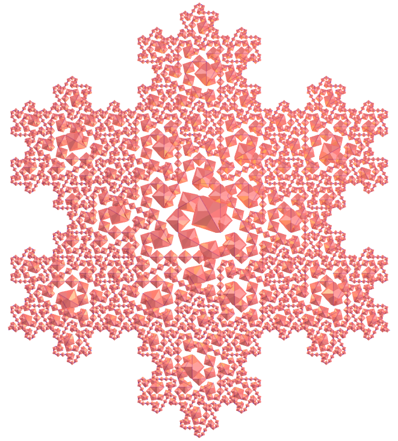</a>
  Fractal de curva de floco de neve do dodecaedro diakis.
  

<h4>7. Grande icositetraedro hexacrônico</h4>
<a href="../vr/curve28.htm" target="_blank" title="modelo 3D" class="fotoA">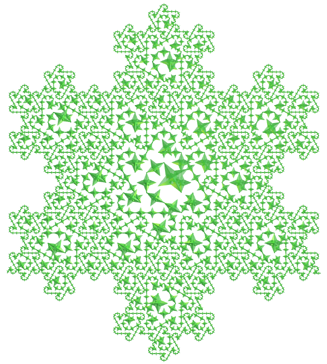</a>
  Fractal de curva de floco de neve do grande icositetraedro hexacrônico.
  

<h4>8. Grande icosaedro triâmbico</h4>
<a href="../vr/curve34.htm" target="_blank" title="modelo 3D" class="fotoA">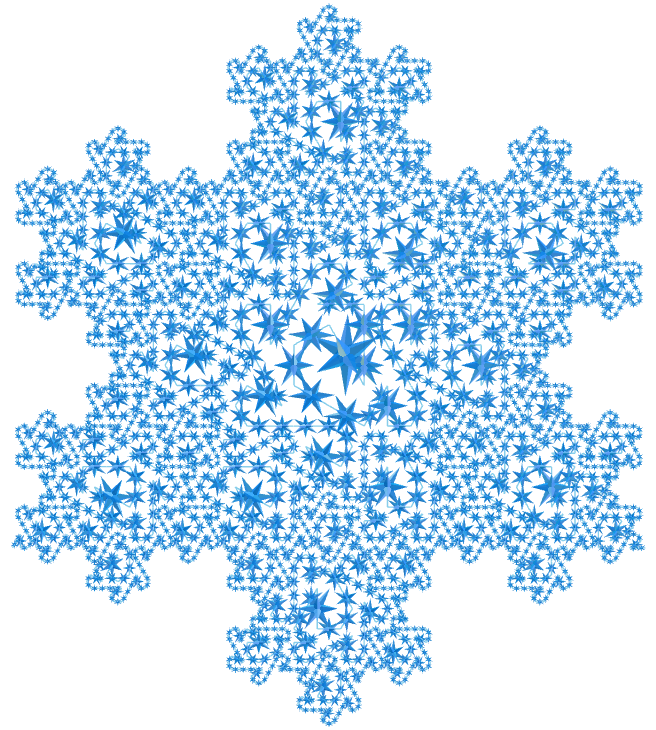</a>
  Fractal de curva de floco de neve do grande icosaedro triâmbico.
  

<h4>9. Grande rombicuboctaedro uniforme</h4>
<a href="../vr/curve36.htm" target="_blank" title="modelo 3D" class="fotoA">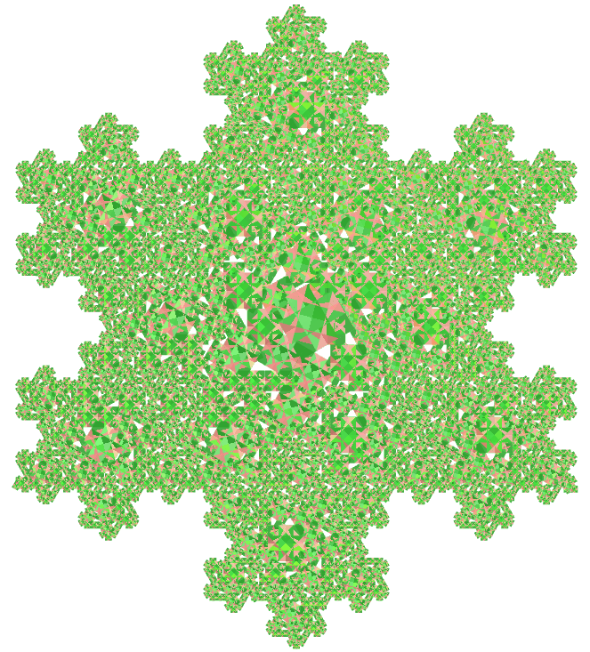</a>
  Fractal de curva de floco de neve do grande rombicuboctaedro uniforme.
  

<h4>10. Grande octaedro triakis</h4>
<a href="../vr/curve46.htm" target="_blank" title="modelo 3D" class="fotoA">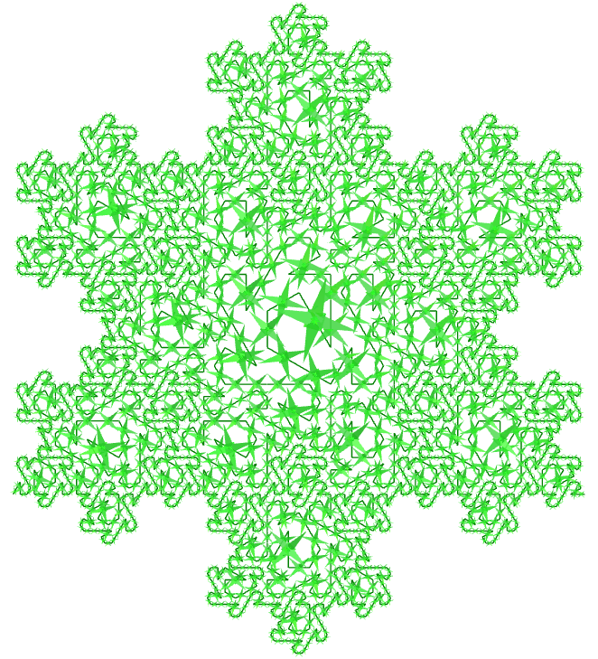</a>
  Fractal de curva de floco de neve do grande octaedro triakis.
  

<a href="#p1" class="topo">voltar ao topo</a>

<h4>11. Mapa de Klein</h4>
<a href="../vr/curve52.htm" target="_blank" title="modelo 3D" class="fotoA">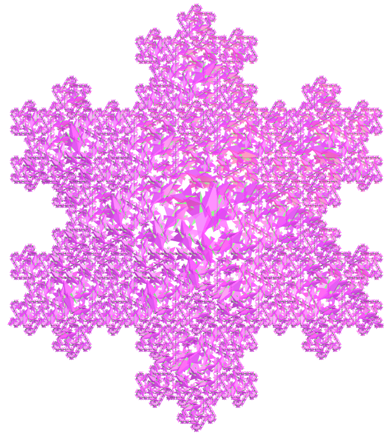</a>
  Fractal de curva de floco de neve do mapa de Klein.
  

<h4>12. Grande triacontaedro disdiakis</h4>
<a href="../vr/curve56.htm" target="_blank" title="modelo 3D" class="fotoA">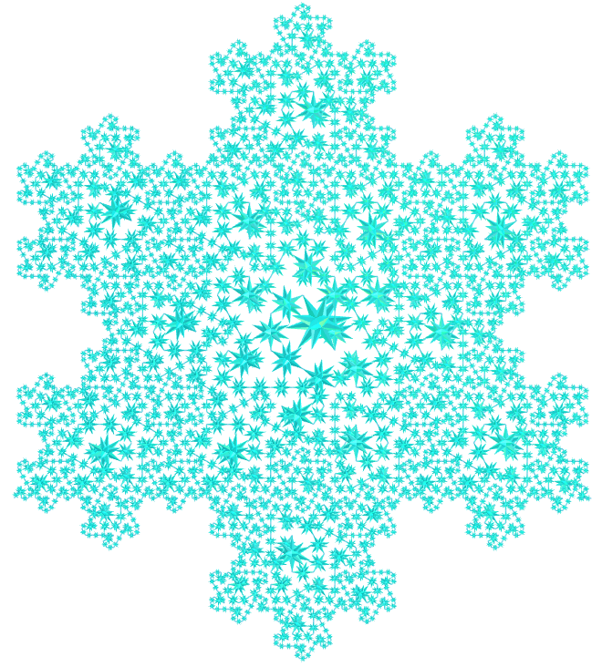</a>
  Fractal de curva de floco de neve do grande triacontaedro disdiakis.
  

<h4>13. Cubo truncado combinado</h4>
<a href="../vr/curve57.htm" target="_blank" title="modelo 3D" class="fotoA">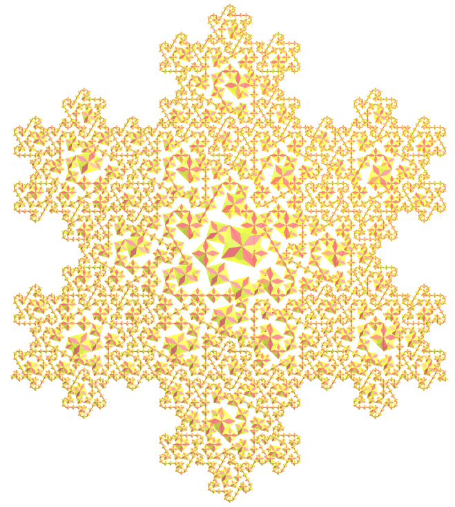</a>
  Fractal de curva de floco de neve do cubo truncado combinado.
  

<h4>14. Tetraedro truncado</h4>
<a href="../vr/curve66.htm" target="_blank" title="modelo 3D" class="fotoA">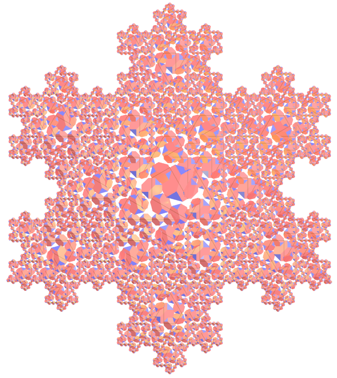</a>
  Fractal de curva de floco de neve do tetraedro truncado.
  

<h4>15. Dodecaedro heptagonal</h4>
<a href="../vr/curve76.htm" target="_blank" title="modelo 3D" class="fotoA">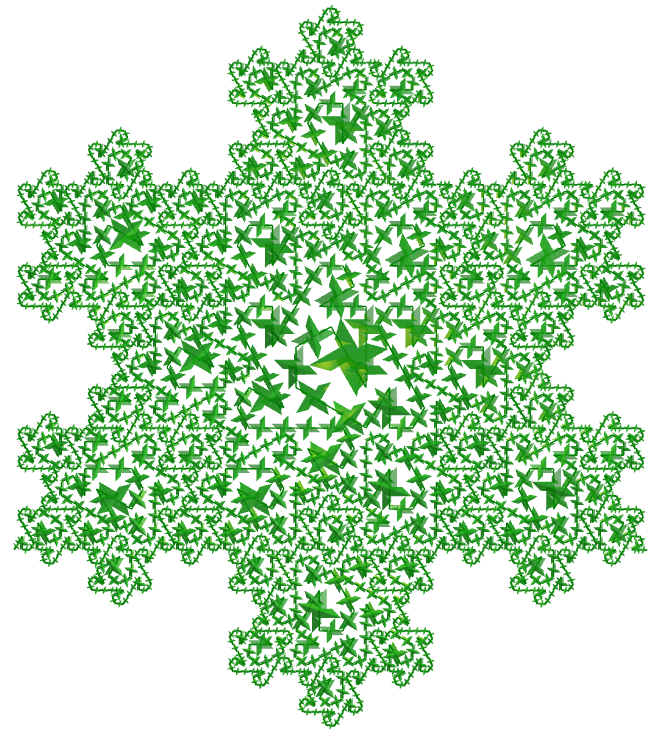</a>
  Fractal de curva de floco de neve do dodecaedro heptagonal.
  

<h4>16. Mapa regular</h4>
<a href="../vr/curve86.htm" target="_blank" title="modelo 3D" class="fotoA">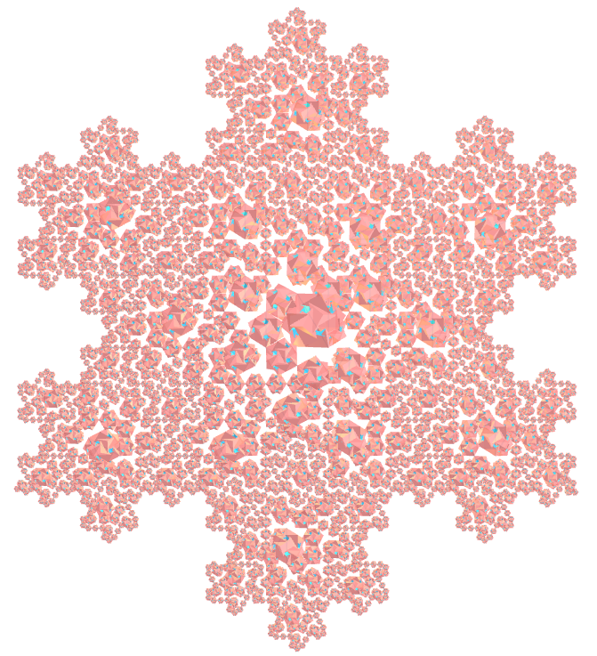</a>
  Fractal de curva de floco de neve do mapa regular.
  

<h4>17. Prisma hexagonal</h4>
<a href="../vr/curve90.htm" target="_blank" title="modelo 3D" class="fotoA">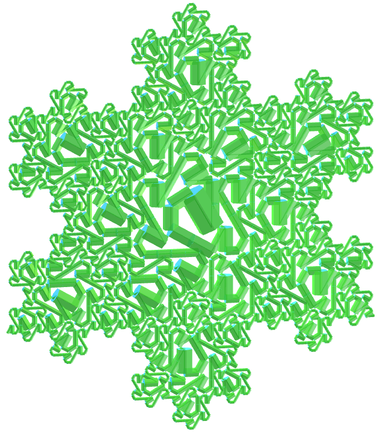</a>
  Fractal de curva de floco de neve do prisma hexagonal.
  

<h4>18. Flor da vida</h4>
<a href="../vr/curve106.htm" target="_blank" title="modelo 3D" class="fotoA">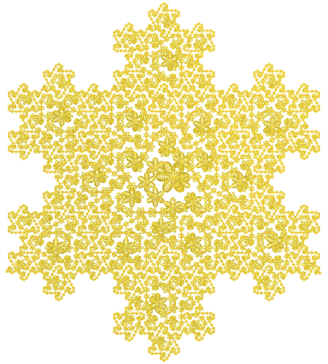</a>
  Fractal de curva de floco de neve do Flor da vida.
  

<h4>19. Octaedro hexakis de Möbius</h4>
<a href="../vr/curve116.htm" target="_blank" title="modelo 3D" class="fotoA">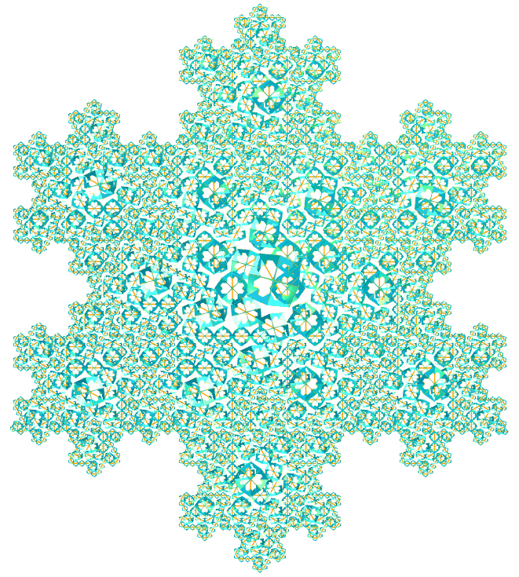</a>
  Fractal de curva de floco de neve do octaedro hexakis de Möbius.
  

<h4>20. Hexecontaedro medial icosacrônico</h4>
<a href="../vr/curve126.htm" target="_blank" title="modelo 3D" class="fotoA">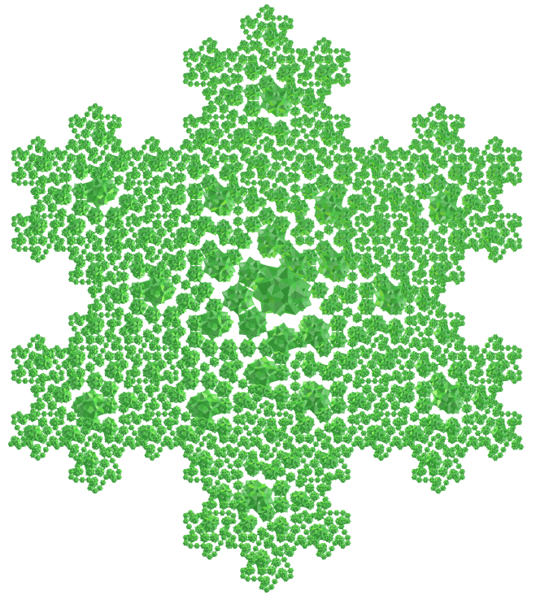</a>
  Fractal de curva de floco de neve do hexecontaedro medial icosacrônico.
  

<a href="#p1" class="topo">voltar ao topo</a>

<h4>21. Grande rombihexacro</h4>
<a href="../vr/curve136.htm" target="_blank" title="modelo 3D" class="fotoA">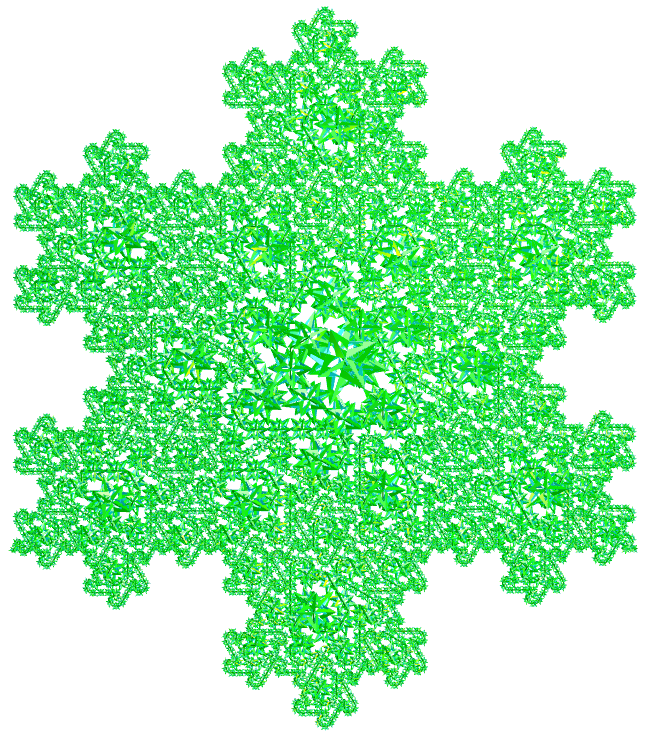</a>
  Fractal de curva de floco de neve do grande rombihexacro.
  

<a href="#p1" class="topo">voltar ao topo</a>

  Snowflake curve fractals with polyhedra: visualization with Virtual Reality de <a xmlns:cc="http://creativecommons.org/ns#" href="https://paulohscwb.github.io/fractalcurves/snowflake/pt-br/" property="cc:attributionName" rel="cc:attributionURL">Paulo Henrique Siqueira</a> está licenciado com uma Licença <a rel="license" href="http://creativecommons.org/licenses/by-nc-nd/4.0/">Creative Commons Atribuição-NãoComercial-SemDerivações 4.0 Internacional</a>.

<h4>Como citar este trabalho:</h4> 

Siqueira, P.H., "Snowflake curve fractals with polyhedra: visualization with Virtual Reality". Disponível em: <https://paulohscwb.github.io/fractalcurves/snowflake/pt-br/>, Novembro de 2026.

<!---->
  <b>Referências:</b>
 Ventrella, Jeffrey. "Fractal curves". <a href="http://fractalcurves.com/" target="_blank">http://fractalcurves.com/</a>
 Weisstein, Eric W. "Uniform Polyhedron." From MathWorld--A Wolfram Web Resource. <a href="https://mathworld.wolfram.com/UniformPolyhedron.html" target="_blank">https://mathworld.wolfram.com/UniformPolyhedron.html</a>
 McCooey, D. I. "Visual Polyhedra". <a href="http://dmccooey.com/polyhedra/" target="_blank">http://dmccooey.com/polyhedra/</a>
